<div align="center">

# 🛡️ Valida School

### Sistema Inteligente de Controle e Segurança na Saída Escolar
**Dupla Validação (PIN Dinâmico + Biometria Facial com Prova de Vida) • Modo Família Multi-Irmãos • Modo Van Escolar • Conformidade LGPD (Art. 14)**

[](https://nodejs.org/)
[](https://react.dev/)
[](https://sqlite.org/)
[](./DOCKER.md)
[](./docs/implantacao_e_lgpd.md)

</div>

---

## 🎯 Visão Geral

O **Valida School** é uma plataforma web corporativa (*on-premise* ou nuvem) projetada para eliminar filas na portaria e garantir segurança jurídica e operacional na entrega de alunos em escolas e creches de todo o Brasil.

O sistema opera com **4 interfaces sincronizadas em tempo real via WebSockets**, arquitetura *offline-first* resiliente no navegador e banco relacional **N:N** em SQLite:

1. **🖥️ Totem da Portaria (`/totem`):** terminal touchscreen ou mobile onde o responsável ou operador digita matrícula/CPF, valida o PIN de 6 dígitos e passa pelo reconhecimento facial com escolha de câmera e prova de vida. Inclui **Modo Van Escolar em lote** e **Código Secreto Diário** para liberação administrativa.
2. **📱 App dos Pais (`/responsavel`):** portal *mobile-first* onde o responsável legal seleciona filhos, gera PIN familiar único (15 min), cadastra/edita/apaga terceiros e vans com **Termo Eletrônico LGPD**, edita apenas sua foto/contato e realiza **Teste de Reconhecimento Facial** antes de ir à escola.
3. **🏫 Painel da Coordenação (`/escola`):** painel administrativo para consulta do **Código Secreto Diário**, monitoramento ao vivo de saídas e alertas, visualização de certificados LGPD, exportação do **Livro Oficial (CSV)** e gestão de alunos/matrículas.
4. **📺 Painel TV das Salas (`/chamada`):** tela para Smart TVs em salas de aula e pátio com atualização instantânea via WebSocket e anúncio por voz (`TTS pt-BR`).

---

## 🏗️ Arquitetura do Ecossistema

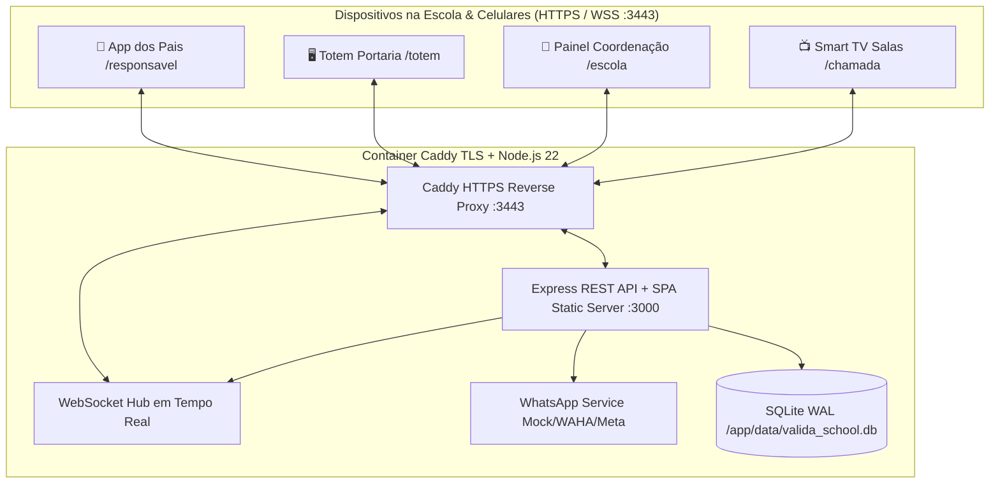

---

## 📸 Galeria de Interfaces

### 1. Hub Principal (`/`)
Seleção rápida do papel de operação de cada terminal ou dispositivo na rede.
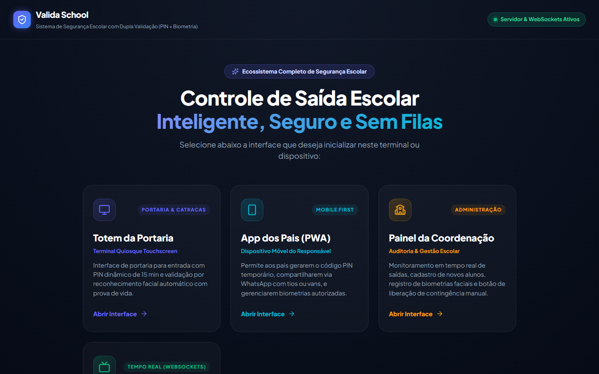

---

### 2. App do Responsável (`/responsavel`)
| Liberação & PIN Familiar Multi-Irmãos | Gestão de Autorizados & Vans (LGPD) | Perfil Editável & Teste Facial |
| :---: | :---: | :---: |
| 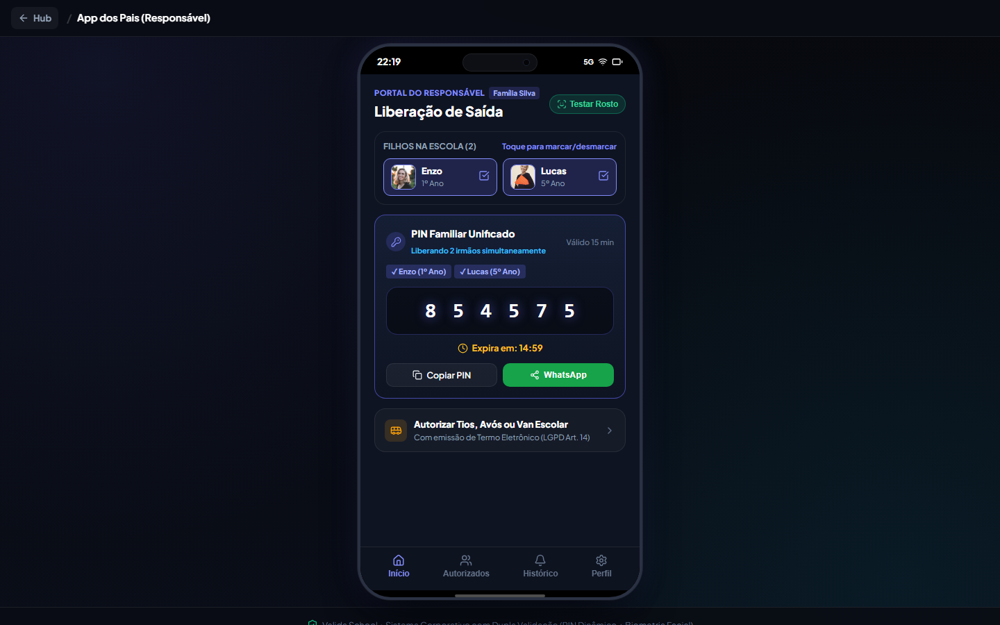 | 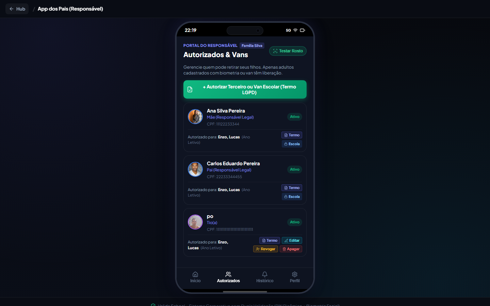 | 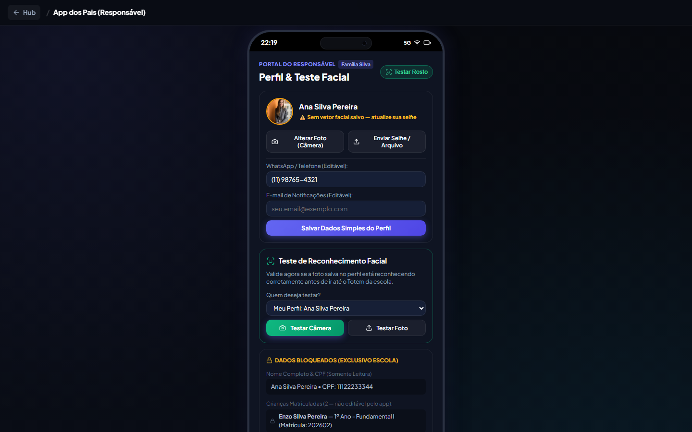 |

**Destaques de Governança no App dos Pais:**
- **PIN Familiar Único:** selecionando 1 ou vários irmãos, um único código de 6 dígitos libera todos simultaneamente na portaria.
- **Terceiros e Vans:** o responsável cadastra tios, avós, babás ou motoristas de van com captura de foto biométrica e emissão de Termo Eletrônico, podendo **editar**, **revogar** ou **apagar** seus terceiros. Responsáveis legais cadastrados pela escola exibem cadeado (`Escola 🔒`).
- **Perfil Restrito + Self-Check Biométrico:** o pai altera foto, WhatsApp e e-mail, mas **CPF, nome civil, matrícula e filhos cadastrados ficam bloqueados** para edição exclusiva da escola. Na mesma aba, pode testar sua câmera/selfie para confirmar se a foto será aprovada pelo Totem (`>= 68%` de similaridade).

---

### 3. Totem Inteligente de Portaria (`/totem`)
| Identificação por Matrícula ou CPF | Validação de PIN & Código Diário | Modo Van Escolar (Embarque em Lote) |
| :---: | :---: | :---: |
| 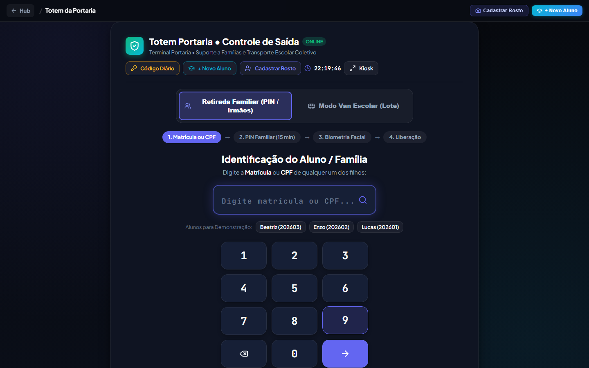 | 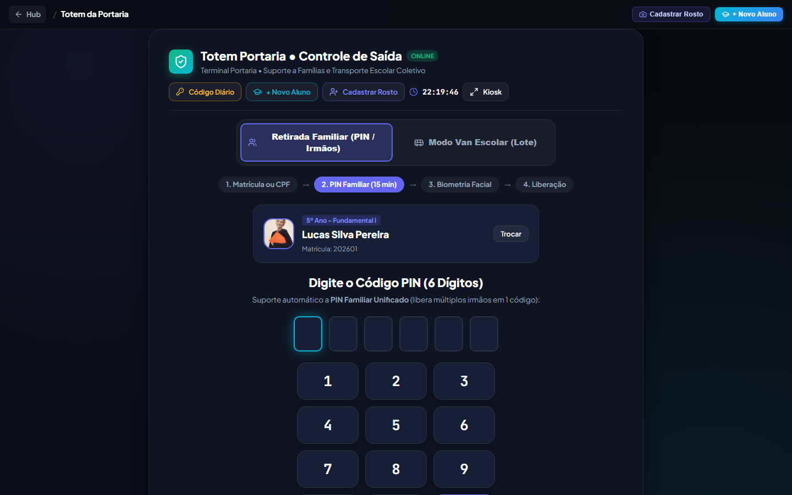 | 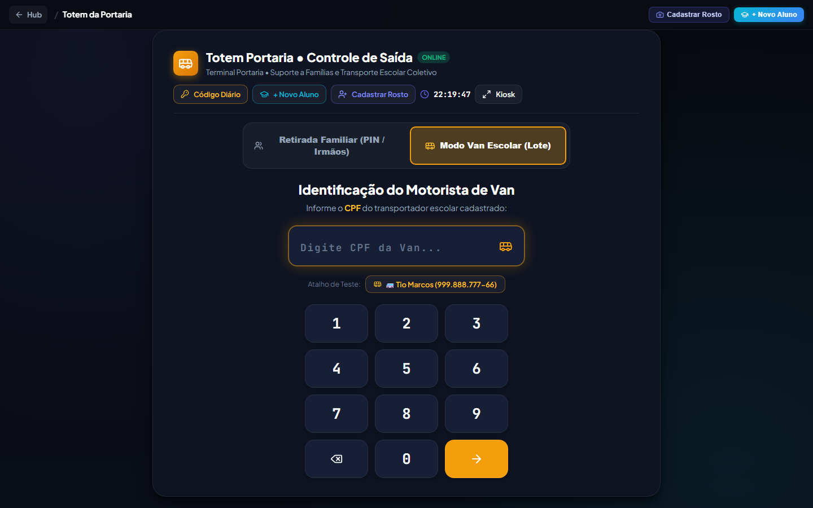 |

**Destaques Operacionais do Totem:**
- **Seletor de Câmera e Múltiplas Tentativas:** troca de webcam/câmera frontal em tempo real e botão **Tentar Novamente** sem perder o fluxo do aluno.
- **Prova de Vida (Liveness):** monitora 68 pontos faciais e *Eye Aspect Ratio (EAR)* para evitar fraudes com fotos impressas ou telas.
- **Código Secreto Diário:** botão dedicado permite que um funcionário autorizado libere a criança sem PIN nem biometria utilizando o código diário rotativo consultado na Coordenação.

---

### 4. Painel da Coordenação (`/escola`) e Smart TV (`/chamada`)
| Código Secreto Diário & Auditoria ao Vivo | Gestão Oficial de Alunos & Matrículas |
| :---: | :---: |
| 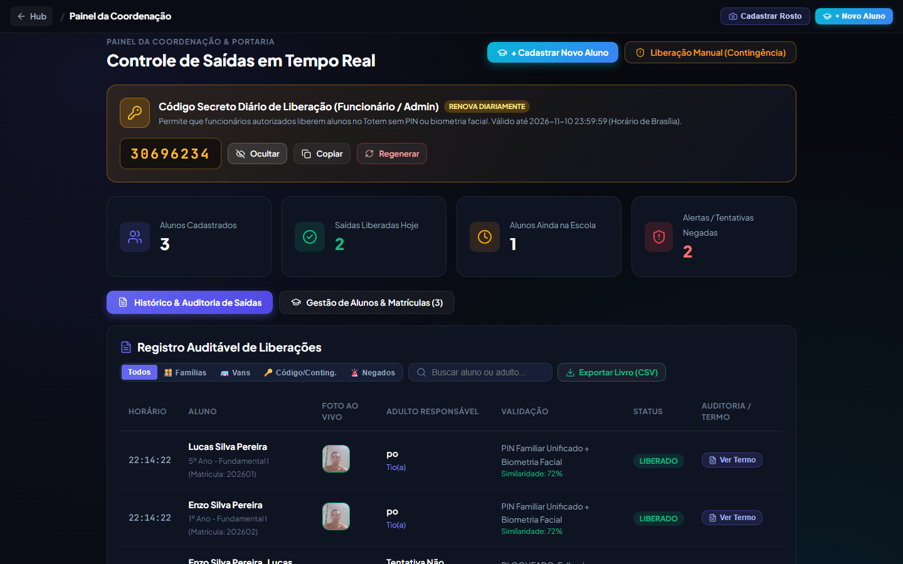 | 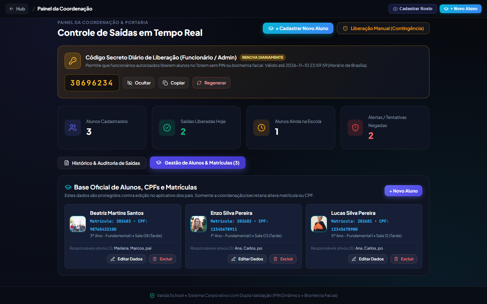 |

| Painel Smart TV das Salas de Aula (`/chamada`) |
| :---: |
| 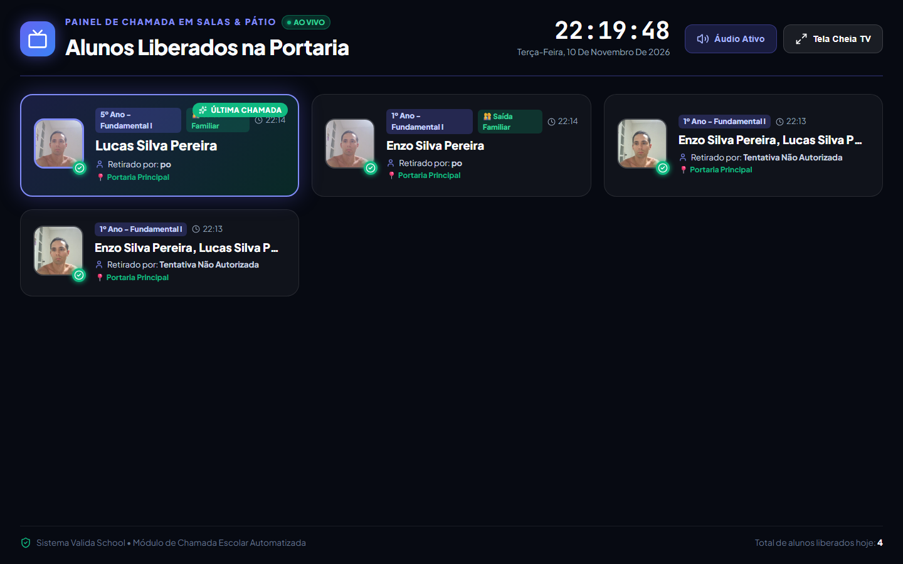 |

---

## 🔒 Recursos de Segurança e Conformidade

- **Modelagem Relacional N:N:** um responsável pode retirar múltiplos filhos; um aluno pode possuir múltiplos responsáveis legais, terceiros temporários e transportadores homologados.
- **Anti-Brute-Force:** bloqueio temporário preventivo por 5 minutos após 3 tentativas incorretas de PIN, com registro imediato de alerta de segurança no Painel da Coordenação.
- **Código Secreto Diário Automático:** renovado todo dia à `00:00` (fuso `America/Sao_Paulo`), com possibilidade de rotação emergencial instantânea pelo gestor em `/escola`.
- **Resguardo Jurídico LGPD (Art. 14) & ECA:** geração de certificado digital imprimível/PDF para cada autorização emitida e exportação de planilha oficial CSV (`UTF-8 BOM`).

---

## 🛠️ Stack Tecnológica

- **Frontend:** React 19, Vite 8, React Router 7, Lucide Icons, Canvas Confetti.
- **Biometria Facial no Navegador:** `@vladmandic/face-api` (modelos TinyFaceDetector, FaceLandmark68 e FaceRecognition 128-D servidos localmente de `public/models/`).
- **Backend Central:** Node.js 22 (`node:sqlite` nativo com modo WAL), Express 5, `ws` (WebSocket Hub).
- **Infraestrutura & HTTPS:** Docker Multi-Stage (`node:22-alpine`) + Caddy Reverse Proxy (`caddy:alpine`) com TLS automático para liberação de câmera na rede local.
- **Qualidade de Código:** Oxlint estrito (`0` erros / `0` avisos).

---

## 📁 Estrutura do Projeto

```text
valida_school/
├── public/models/             # Modelos neurais locais do face-api (.json e .bin)
├── server/
│   ├── database.js            # Schema SQLite N:N, queries de alunos, PINs, vans e código diário
│   ├── index.js               # Servidor Express (REST API, WebSocket Hub e fallback SPA)
│   └── whatsappService.js     # Serviço agnóstico de WhatsApp (Mock, WAHA/Evolution, Meta API)
├── src/
│   ├── components/
│   │   ├── PortalHub.jsx      # Hub inicial de escolha de módulo
│   │   ├── GuardianView.jsx   # App dos pais (PIN familiar, terceiros, perfil, teste facial)
│   │   ├── TotemView.jsx      # Terminal de portaria (PIN, biometria, van, código diário)
│   │   ├── SchoolView.jsx     # Painel coordenação (código diário, logs, CSV, gestão alunos)
│   │   ├── CallBoardView.jsx  # Painel Smart TV em tempo real com voz (TTS)
│   │   ├── ThirdPartyModal.jsx# Cadastro/edição de terceiros/vans + biometria + termo LGPD
│   │   ├── TermViewerModal.jsx# Certificado digital imprimível/PDF da autorização
│   │   ├── StudentModal.jsx   # Matrícula e edição de alunos (exclusivo escola)
│   │   └── RegisterModal.jsx  # Captura facial rápida via webcam ou upload
│   ├── services/
│   │   ├── apiService.js      # Cliente HTTP/WebSocket com detecção automática de HTTPS/WSS
│   │   ├── faceService.js     # Motor neural 128-D, câmera, EAR liveness e comparação
│   │   ├── storage.js         # Cache reativo offline-first + sincronização WebSocket
│   │   └── audioService.js    # Efeitos Web Audio API e síntese de voz pt-BR
│   ├── App.jsx                # Roteamento e governança global de barra superior
│   └── index.css              # Design System Dark Biometric Glass + responsividade mobile
├── docs/screenshots/          # Capturas oficiais utilizadas neste README
├── Dockerfile                 # Build Multi-Stage de produção (Node 22 Alpine)
├── docker-compose.yml         # Stack App (:3080 HTTP) + Caddy TLS (:3443 HTTPS)
├── Caddyfile                  # Configuração de proxy reverso seguro com WebSockets
└── DOCKER.md                  # Manual completo de operação, backup e restauração
```

---

## 🔌 Principais Endpoints da API REST

| Método | Rota | Descrição |
| :--- | :--- | :--- |
| `GET` | `/api/health` | Status de integridade da API |
| `GET` / `POST` / `PUT` / `DELETE` | `/api/alunos` | Listagem N:N e gestão escolar completa de matrículas |
| `PUT` | `/api/responsaveis/:id/perfil` | Edição restrita do perfil do pai (foto, telefone e e-mail) |
| `POST` / `PUT` / `DELETE` | `/api/autorizacoes/*` | CRUD de terceiros/vans com proteção contra alteração de `LEGAL` |
| `POST` | `/api/pins/gerar-familiar` | Geração sincronizada de PIN individual ou para irmãos |
| `POST` | `/api/pins/validar` | Validação do PIN e retorno consolidado dos alunos |
| `GET` / `POST` | `/api/vans/*` | Consulta de rota e embarque coletivo em lote |
| `GET` / `POST` | `/api/admin/codigo-diario` | Consulta e rotação do Código Secreto Diário |
| `POST` | `/api/admin/validar-codigo-diario` | Liberação administrativa direta no Totem sem PIN/biometria |
| `POST` / `GET` | `/api/saidas/registrar`, `/api/logs` | Registro auditável de saídas e alertas de segurança |

---

## 🚀 Como Rodar o Projeto

### Opção 1 — Docker Compose com HTTPS Ativado (Recomendado para Servidores e Rede Local)

Navegadores modernos exigem **HTTPS** para liberar acesso à câmera em dispositivos na rede local. O `docker-compose.yml` já sobe o aplicativo e um proxy **Caddy HTTPS** na porta `3443`:

```bash
docker compose up -d --build
```

- **Acesso Seguro (Câmera + WebSocket Seguro):** `https://SEU_IP_SERVIDOR:3443`
- **Acesso HTTP Padrão:** `http://SEU_IP_SERVIDOR:3080`

Consulte o [DOCKER.md](DOCKER.md) para comandos de backup, restauração do volume SQLite (`/app/data/valida_school.db`) e implantação com Nginx.

### Opção 2 — Desenvolvimento Local

Requer **Node.js 22+**:

```bash
# 1. Instalar dependências
npm install

# 2. Terminal 1 — Iniciar Backend REST + WebSocket + SQLite (:3001)
npm run server

# 3. Terminal 2 — Iniciar Frontend Vite (:5173)
npm run dev
```

### Scripts de Qualidade e Build

```bash
npm run lint   # Verificação estrita com Oxlint
npm run build  # Compilação de produção em dist/
```
